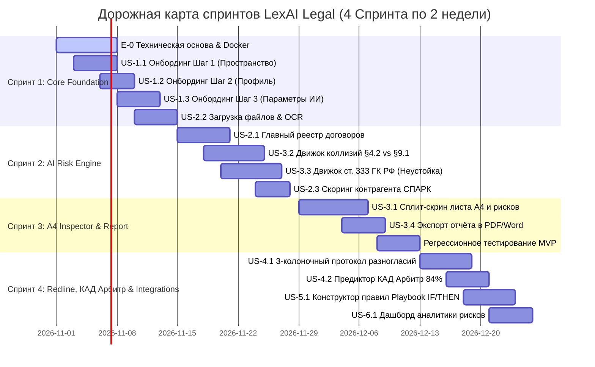

# 🏛️ Организация проекта в GitHub Projects: ИИ-аналитик юридических документов (LexAI Legal)

**Студент:** К.А. Фёдоров (группа 1-41м)  
**Курс:** Управление жизненным циклом ПО  
**Преподаватель:** доц., канд. техн. наук А.М. Садыков  
**ИГЭУ, Кафедра ПОКС, 2026**

---

## 🎯 1. Организация проекта в GitHub Projects

Работа по управлению жизненным циклом программного продукта «ИИ-аналитик для проверки юридических документов на риски и противоречия» (LexAI Legal) организована в сервисе **GitHub Projects** в соответствии с гибкой методологией **Scrum**.

### 🗓️ Структура спринтов
Весь цикл разработки разбит на **4 двухнедельных спринта**:
* **Спринт 1:** «Создание технической основы, онбординг и загрузка документов» (E-0, E-1, часть E-2).
* **Спринт 2:** «Движок ИИ-анализа рисков, проверка коллизий и реестр договоров» (E-2, E-3).
* **Спринт 3:** «Интерактивный сплит-скрин A4, карточки замечаний и экспорт отчёта» (E-4, MVP Release).
* **Спринт 4:** «Redline Diff протокол разногласий, КАД Арбитр, Playbook и интеграции» (E-5, E-6).

### 📊 Колонки Канбан-доски (Board Workflow)
1. **📥 Product Backlog** — Общий упорядоченный список требований, пользовательских историй и технических задач.
2. **🎯 Sprint Backlog (Ready for Dev)** — Задачи, взятые в текущий двухнедельный спринт, с декомпозицией на атомарные действия (tasks).
3. **⚙️ In Progress** — Задачи в активной ветке разработки (`feature/*`, `fix/*`).
4. **🔍 Code Review & Legal QA** — Проверка кода (Pull Request), автоматические тесты и верификация точности юридических формулировок.
5. **🚀 Done** — Задачи, прошедшие критерии готовности (Definition of Done) и развёрнутые в окружении.

### 🏷️ Система меток (Labels)
* `epic` — крупный функциональный блок системы (E-0 ... E-6);
* `story` — пользовательская история (US-X.Y);
* `action:frontend` — подзадача разработки клиентской части (Next.js / React / Tailwind);
* `action:backend` — подзадача серверной логики и API (FastAPI / PostgreSQL / MinIO);
* `action:ai` — подзадача настройки промптов и интеграции языковых моделей (LLM / RAG / OCR);
* `action:qa` — подзадача написания тестов и валидации правовых сценариев;
* `priority:p0-blocker`, `priority:p1-high`, `priority:p2-medium`.

---

## 📖 2. Общая терминология (Таблица 1.4)

| № | Термин / Сокращение | Определение |
| :-: | :--- | :--- |
| 1 | **LexAI Legal** | Веб-ориентированная программная платформа ИИ-анализа договоров, выявления правовых рисков и автоматизированной генерации протоколов разногласий. |
| 2 | **LLM (Large Language Model)** | Большая языковая модель (GigaChat Enterprise, Legal-BERT), используемая для семантического анализа текста, извлечения сущностей и формулирования безопасных редакций. |
| 3 | **Правовая коллизия** | Внутреннее логическое или нормативное противоречие между различными пунктами, разделами или приложениями одного и того же договора (например, разные сроки уведомления). |
| 4 | **Несоразмерная неустойка (ст. 333 ГК РФ)** | Завышенная ставка договорной неустойки (пени/штрафа), явно несоразмерная последствиям нарушения обязательства (например, 0.5% в день = 182.5% годовых против рыночных 0.05%–0.1%). |
| 5 | **Contra proferentem** | Общепринятый принцип толкования договора против стороны, которая подготовила спорный проект (п. 11 Постановления Пленума ВС РФ № 49). |
| 6 | **Протокол разногласий** | Официальный юридический документ, содержащий сравнительную таблицу спорных пунктов в трёх колонках (редакция поставщика, редакция покупателя, обоснование). |
| 7 | **КАД Арбитр (`kad.arbitr.ru`)** | Официальная картотека арбитражных дел РФ; источник судебной практики для предиктора исхода ходатайств по снижению неустойки. |
| 8 | **Корпоративный Playbook** | Свод утверждённых правил и стандартных безопасных формулировок компании (матрица IF/THEN), обязательных для включения в договоры. |
| 9 | **СПАРК** | Автоматизированная система проверки благонадёжности контрагентов по ИНН/ОГРН, рассчитывающая индекс должной осмотрительности (ИДО). |
| 10 | **Контур.Диадок** | Система юридически значимого электронного документооборота (ЭДО), поддерживающая подписание протоколов квалифицированной электронной подписью (КЭП). |
| 11 | **Redline Diff** | Визуальное отображение правок в тексте: удаляемые фрагменты выделяются красным зачёркиванием, добавляемые — зелёным цветом. |
| 12 | **OCR (Optical Character Recognition)** | Оптическое распознавание символов для извлечения печатного текста из сканированных PDF-копий и изображений договоров. |
| 13 | **152-ФЗ** | Федеральный закон «О персональных данных», регламентирующий требования к защите и обработке конфиденциальной информации на территории РФ. |
| 14 | **Сплит-скрин инспектор** | Двухколоночный интерфейс: слева виртуальный лист договора формата A4 с интерактивными цветными маркерами, справа — панель выявленных рисков. |

---

## 🏛️ 3. Реестр элементов-эпиков (Epics)

* **E-0: «Создание технической основы и окружения»** — Репозиторий GitHub, CI/CD, Docker Compose (FastAPI, Next.js, PostgreSQL + pgvector, MinIO S3, Redis), фирменная дизайн-система.
* **E-1: «Управление аккаунтом, онбординг и профиль»** — Аутентификация, 3-шаговый мастер настройки пространства организации, профиль юриста и конфигурация параметров аудита.
* **E-2: «Загрузка и первичная обработка документов»** — Drag & drop загрузка PDF/DOCX, модуль OCR, извлечение текста, классификация типа договора, скоринг контрагента по СПАРК.
* **E-3: «Движок ИИ-анализа рисков и коллизий»** — Поиск логических противоречий между разделами (§4.2 vs §9.1), выявление явно несоразмерной неустойки (ст. 333 ГК РФ), односторонний отказ (ст. 310, 450.1 ГК РФ).
* **E-4: «Интерактивный просмотрщик A4 и формирование отчётности»** — Сплит-скрин просмотрщик листа A4 с подсветкой, раскрывающиеся карточки замечаний, экспорт отчёта в PDF/Word.
* **E-5: «Протокол разногласий Redline, КАД Арбитр и Playbook»** — 3-колоночный протокол разногласий, судебный предиктор побед (84%), калькулятор предотвращённых потерь, правила IF/THEN, интеграции 1С и Диадок.
* **E-6: «Аналитика договорных рисков и управление командой»** — Матрица рисков по категориям, помесячный тренд рисков, роли доступа юристов, журнал аудита 152-ФЗ.

---

## 📋 4. Детальные спецификации User Stories с декомпозицией на ДЕЙСТВИЯ

---

### [US-1.1] 3-шаговый мастер настройки пространства организации (Онбординг, Шаг 1)
* **Эпик:** `E-1: Управление аккаунтом, онбординг и профиль`
* **User Story:** *Как юрист или руководитель юридического департамента, я хочу ввести название организации, выбрать отрасль и отметить типы договоров компании, чтобы система автоматически откалибровала правила проверки под наш профиль деятельности.*
* **Терминология:** LexAI Legal, Корпоративный Playbook, 152-ФЗ (п. 1, 8, 13).
* **Цель:** Первичная инициализация рабочего пространства компании с адаптацией ИИ под отраслевую специфику.

#### 🎯 Задачи пользователя:
1. Запустить веб-приложение и перейти к Шагу 1 онбординга.
2. Ввести наименование организации в текстовое поле «Название компании».
3. Раскрыть выпадающий список «Отрасль» и выбрать отраслевую направленность.
4. Отметить один или несколько чипов типов договоров (`✓ Договоры поставки`, `✓ Лицензионные соглашения`, `✓ NDA и тайна`).
5. Нажать кнопку «→ Далее к профилю» для перехода к Шагу 2.

#### ⚙️ ДЕЙСТВИЯ (Атомарные подзадачи для разработчика):
* **Действие 1.1.1 (Frontend):** Создать экран онбординга `01_Onboarding_Step1` с двухколоночной раскладкой (слева презентационный блок с плашками безопасности, справа карточка формы).
* **Действие 1.1.2 (Frontend):** Реализовать компонент прогресс-бара шагов онбординга (3 сегмента, первый активен терракотовым цветом `#D97757`).
* **Действие 1.1.3 (Frontend):** Создать форму ввода: инпут компании, селектор отрасли, мультиселект чипов типов договоров.
* **Действие 1.1.4 (Backend):** Реализовать эндпоинт `POST /api/v1/workspace/setup-step1` с валидацией Pydantic-схемы (название компании, отрасль, массив строк категорий договоров).
* **Действие 1.1.5 (Backend/DB):** Создать таблицу `workspaces` в PostgreSQL (id, name, industry, contract_types, created_at, user_id).
* **Действие 1.1.6 (QA):** Написать e2e-тест валидации обязательности полей и корректности перехода на Шаг 2.

#### 📋 Список функций и предусловий (Таблица):
| № | Название функции | Краткое описание | Предусловие | Права вызова | Ссылка на требование |
| :-: | :--- | :--- | :--- | :--- | :--- |
| 1 | `initWorkspace` | Инициализация компании и сохранение отраслевого профиля | Пользователь зарегистрирован, открыт экран Шага 1 | Пользователь | US-1.1 |

#### 🔄 Пользовательские сценарии:
* **Основной поток (TC-1.1):**
  1. Пользователь вводит «ООО Меридиан Технолоджис».
  2. Пользователь выбирает отрасль «IT и Цифровые технологии».
  3. Пользователь кликает по чипам «Договоры поставки» и «Лицензионные соглашения».
  4. Пользователь нажимает кнопку «→ Далее к профилю».
  5. Система валидирует данные, сохраняет запись в БД и перенаправляет на Шаг 2.
* **Альтернативный поток (TC-1.1-A):**
  1. Пользователь выбирает все три типа договоров. Чипы окрашиваются пастельно-терракотовой заливкой.
* **Исключение (TC-1.1-E):**
  1. Пользователь оставляет поле компании пустым и нажимает «Далее».
  2. Система подсвечивает поле красной рамкой `#DC2626` и выводит сообщение: «Введите название компании». Переход блокируется.

#### 🖥️ Шаблон интерфейса: Шаг 1 Онбординга (Таблица элементов)
| Элемент | Описание | Тип | Обязательность | Значение по умолчанию |
| :--- | :--- | :--- | :-: | :--- |
| Инпут компании | Наименование юридического лица | Текстовое поле | Да | «Например, Meridian Technologies» |
| Селектор отрасли | Сфера хозяйственной деятельности | Dropdown | Да | «IT и Цифровые технологии» |
| Чипы договоров | Множественный выбор типов соглашений | Multi-select chips | Да | «✓ Договоры поставки» |
| Кнопка «Далее» | Переход к шагу настройки профиля юриста | Кнопка CTA | Да | «→ Далее к профилю» |

---

### [US-1.2] Персонализация профиля юриста и доверенности (Онбординг, Шаг 2)
* **Эпик:** `E-1: Управление аккаунтом, онбординг и профиль`
* **User Story:** *Как практикующий юрист, я хочу указать свои имя, отчество, должность и реквизиты доверенности с мгновенным предпросмотром карточки, чтобы система автоматически подставляла мои данные в формируемые протоколы разногласий.*
* **Терминология:** LexAI Legal, Протокол разногласий (п. 1, 6).
* **Цель:** Привязка цифровой личности юриста к формируемым юридическим документам.

#### 🎯 Задачи пользователя:
1. Ознакомиться с полями Шага 2 («Ваше имя и отчество», «Должность»).
2. Ввести ФИО (например, «Алексей Смирнов»).
3. Увидеть интерактивное обновление карточки предпросмотра профиля справа (аватар «АС», компания, должность).
4. Нажать кнопку «→ Далее к настройкам ИИ».

#### ⚙️ ДЕЙСТВИЯ (Атомарные подзадачи для разработчика):
* **Действие 1.2.1 (Frontend):** Разработать экран `02_Onboarding_Step2` с прогресс-баром (активны 2 сегмента из 3).
* **Действие 1.2.2 (Frontend):** Реализовать инпут ввода ФИО с маской и валидацией кириллицы.
* **Действие 1.2.3 (Frontend):** Создать реактивный компонент интерактивной визитки (Live Preview Card) с автоматической генерацией инициалов в круговом бейдже.
* **Действие 1.2.4 (Backend):** Реализовать эндпоинт `POST /api/v1/profile/setup-step2` для сохранения профиля юриста.
* **Действие 1.2.5 (Backend/DB):** Добавить колонки `full_name`, `role_title`, `department` в таблицу `users`.
* **Действие 1.2.6 (QA):** Проверить генерацию инициалов для сложных имён и работу кнопки «← Назад» с сохранением введённого текста.

---

### [US-1.3] Конфигурация параметров проверки ИИ и глубина аудита (Онбординг, Шаг 3)
* **Эпик:** `E-1: Управление аккаунтом, онбординг и профиль`
* **User Story:** *Как юрист компании, я хочу включить или выключить автоматический поиск коллизий, проверку неустоек по ст. 333 ГК РФ и выбрать глубину анализа, чтобы система проверяла документы в соответствии с регламентом компании.*
* **Терминология:** Правовая коллизия, ст. 333 ГК РФ, Contra proferentem, 152-ФЗ (п. 3, 4, 5, 13).
* **Цель:** Тонкая настройка строгости проверок и скорости работы ИИ-движка.

#### 🎯 Задачи пользователя:
1. Переключить тумблер «Поиск коллизий и противоречий».
2. Переключить тумблер «Выявление скрытых рисков (ст. 333 ГК РФ)».
3. Переключить тумблер «Соответствие законодательству».
4. Выбрать карточку глубины анализа: «Быстрый (15 сек)», «Стандартный (40 сек)» или «Глубокий (детальный аудит)».
5. Нажать кнопку «Начать работу в LexAI Legal →» и перейти в главный реестр договоров.

#### ⚙️ ДЕЙСТВИЯ (Атомарные подзадачи для разработчика):
* **Действие 1.3.1 (Frontend):** Создать экран `03_Onboarding_Step3` с тремя интерактивными свитчами (Switch) и группой радио-карточек глубины анализа.
* **Действие 1.3.2 (Frontend):** Добавить нижнюю плашку с сертификатом шифрования ГОСТ Р 34.12-2015 и 152-ФЗ.
* **Действие 1.3.3 (Backend):** Реализовать эндпоинт `POST /api/v1/workspace/audit-rules` (флаги: `check_collisions`, `check_penalties_333`, `check_statutory`, `audit_depth`).
* **Действие 1.3.4 (Backend):** Инициализировать дефолтный набор правил Playbook в базе данных для созданного пространства.
* **Действие 1.3.5 (Frontend):** Настроить редирект на экран главного дашборда `04_Dashboard_Registry` после успешной отправки формы.

---

### [US-2.1] Главный реестр договоров с фильтрами по рискам (Экран 04)
* **Эпик:** `E-2: Загрузка и первичная обработка документов`
* **User Story:** *Как корпоративный юрист, я хочу видеть централизованный реестр всех договоров с цветовыми статусами рисков, индексами СПАРК и ключевыми замечаниями, чтобы мгновенно выявлять критические договоры, требующие срочного согласования.*
* **Терминология:** СПАРК, Контур.Диадок, Правовая коллизия (п. 3, 9, 10).
* **Цель:** Комплексный мониторинг и управление входящим потоком договоров компании.

#### 🎯 Задачи пользователя:
1. Открыть реестр договоров (вкладка `[ Договоры ]` в верхнем меню).
2. Ознакомиться со сводными KPI-метриками (Договоры в работе, Критические риски, Судебный винрейт 84%, Предотвращённые потери).
3. Переключить вкладку фильтра на «Требуют внимания (7)».
4. Использовать строку поиска для поиска контрагента по названию или ИНН.
5. Нажать кнопку «Инспектор» в строке договора для перехода к детальному анализу.

#### ⚙️ ДЕЙСТВИЯ (Атомарные подзадачи для разработчика):
* **Действие 2.1.1 (Frontend):** Сверстать глобальный навбар с брендом `§ LexAI Legal`, бейджем движка GigaChat Enterprise, 4 горизонтальными вкладками и профилем юриста.
* **Действие 2.1.2 (Frontend):** Реализовать сетку из 4 KPI-карточек с автоматическим форматированием валюты и процентов.
* **Действие 2.1.3 (Frontend):** Создать панель фильтрации с динамическими счётчиками («Все договоры», «Требуют внимания», «На согласовании», «Подписаны») и поисковым инпутом.
* **Действие 2.1.4 (Frontend):** Разработать компонент таблицы договоров (колонки: документ, статус риска, коллизии, СПАРК, действия).
* **Действие 2.1.5 (Backend):** Реализовать эндпоинт `GET /api/v1/contracts` с поддержкой пагинации, сортировки, полнотекстового поиска и фильтрации по enum статуса риска.
* **Действие 2.1.6 (Backend/DB):** Создать таблицы `contracts` и `counterparties` с индексами по `status`, `partner_inn`, `created_at`.

---

### [US-2.2] Загрузка и парсинг договоров (PDF, DOCX, сканы с OCR)
* **Эпик:** `E-2: Загрузка и первичная обработка документов`
* **User Story:** *Как юрист или менеджер, я хочу загрузить договор перетаскиванием (drag-and-drop) или через кнопку «+ Загрузить на анализ», чтобы система автоматически извлекла текст и структуру разделов.*
* **Терминология:** OCR, LexAI Legal (п. 1, 12).
* **Цель:** Бесшовный импорт документов любых форматов в систему для анализа.

#### 🎯 Задачи пользователя:
1. Нажать кнопку «+ Загрузить на анализ» в шапке реестра.
2. Перетащить файл договора (например, `Договор_поставки_412.pdf`) в область загрузки.
3. Наблюдать за индикатором прогресса («Разбор документа» -> «Анализ рисков» -> «Формирование отчёта»).
4. Автоматически перейти на экран результатов после завершения анализа.

#### ⚙️ ДЕЙСТВИЯ (Атомарные подзадачи для разработчика):
* **Действие 2.2.1 (Frontend):** Разработать модальное окно загрузки файлов с поддержкой drag-and-drop и отображением размера и типа файла.
* **Действие 2.2.2 (Backend):** Реализовать эндпоинт `POST /api/v1/contracts/upload` (multipart/form-data) с сохранением исходного файла в S3-хранилище (MinIO).
* **Действие 2.2.3 (Backend/AI):** Реализовать модуль извлечения текста: библиотека `python-docx` для DOCX, `PyMuPDF (fitz)` для текстовых PDF.
* **Действие 2.2.4 (Backend/AI):** Подключить OCR-конвейер (Tesseract / EasyOCR) для распознавания отсканированных копий и PDF-сканов.
* **Действие 2.2.5 (Backend/AI):** Разработать регулярные выражения и LLM-промпт для автоматического разбиения документа на разделы (Преамбула, Предмет, Права и обязанности, Ответственность, Расторжение, Реквизиты).
* **Действие 2.2.6 (Backend):** Настроить асинхронную обработку очереди задач через Celery / Redis с передачей WebSocket-сообщений о прогрессе (82%).

---

### [US-3.1] Сплит-скрин просмотрщик: виртуальный лист A4 и панель замечаний (Экран 05 — Референс 4)
* **Эпик:** `E-4: Интерактивный просмотрщик A4 и формирование отчётности`
* **User Story:** *Как практикующий юрист, я хочу видеть слева интерактивный лист договора формата A4 с подсветкой спорных мест, а справа — сводные чипы рисков и карточки замечаний, чтобы анализировать документ в привычном бумажном представлении.*
* **Терминология:** Сплит-скрин инспектор, Правовая коллизия, ст. 333 ГК РФ (п. 3, 4, 14).
* **Цель:** Максимальное удобство сопоставления рекомендаций ИИ с реальным текстом документа.

#### 🎯 Задачи пользователя:
1. Открыть экран анализа документа `05_Document_Analysis`.
2. Ознакомиться со статус-баром прогресса отчёта («Формируем ваш отчёт: 82%»).
3. В левой колонке просматривать лист договора A4, переключать страницы (`Страница 3 из 12`) и масштаб (`100%`).
4. Видеть в тексте жёлтую плашку §4.2 и красную плашку §7.3.
5. В правой колонке ознакомиться со сводкой чипов: «2 Критических», «5 Средних», «3 Низких».
6. Кликнуть по плашке на листе договора для мгновенного скролла к соответствующей раскрытой карточке справа.

#### ⚙️ ДЕЙСТВИЯ (Атомарные подзадачи для разработчика):
* **Действие 3.1.1 (Frontend):** Сверстать экран `05_Document_Analysis` с разделением 1368px на две колонки (620px левая колонка листа A4, 728px правая колонка карточек).
* **Действие 3.1.2 (Frontend):** Разработать компонент интерактивного листа A4 с рамкой, мягкой тенью, заголовком документа, пейджером и кнопками `‹` `›`.
* **Действие 3.1.3 (Frontend):** Реализовать компоненты цветовых плашек цитат: жёлтая (`#FFFBEB`, бордер `#FDE68A`) для коллизий и красная (`#FEF2F2`, бордер `#FECACA`) для ст. 333 ГК РФ.
* **Действие 3.1.4 (Frontend):** Создать ряд сводных рисковых чипов (2 / 5 / 3) с крупными цифрами и статусной заливкой.
* **Действие 3.1.5 (Frontend):** Реализовать раскрывающиеся карточки замечаний (Accordion Card) с цитатами, обоснованием и блоком «Следующий шаг: ...».
* **Действие 3.1.6 (Backend):** Реализовать эндпоинт `GET /api/v1/contracts/{id}/analysis` возвращающий структурированный JSON с найденными рисками, цитатами, номерами страниц и координатами подсветки.

---

### [US-3.2] Выявление и правовая квалификация коллизий (§4.2 vs §9.1)
* **Эпик:** `E-3: Движок ИИ-анализа рисков и коллизий`
* **User Story:** *Как юрист, я хочу, чтобы система находила противоречивые условия в разных пунктах договора (например, срок расторжения 30 дней в §4.2 против 60 дней в §9.1), чтобы устранить риск судебного спора по правилу contra proferentem.*
* **Терминология:** Правовая коллизия, Contra proferentem (п. 3, 5).
* **Цель:** Автоматическое обнаружение скрытых взаимных противоречий между разделами договора.

#### 🎯 Задачи пользователя:
1. Увидеть на листе A4 подсвеченный пункт: «§ 4.2 · ПРОТИВОРЕЧИЕ С § 9.1».
2. Раскрыть Карточку 1 в правой колонке.
3. Прочитать сопоставление цитат: §4.2 (30 дней) и §9.1 (60 дней).
4. Ознакомиться с предупреждением о риске толкования судом не в пользу компании.
5. Принять рекомендацию: «Согласовать единый срок уведомления 45 дней либо исключить пункт 4.2».

#### ⚙️ ДЕЙСТВИЯ (Атомарные подзадачи для разработчика):
* **Действие 3.2.1 (AI Engine):** Сформировать специализированный Few-Shot промпт для LLM, сопоставляющий условия об изменении и расторжении договора из разделов 4 и 9.
* **Действие 3.2.2 (Backend):** Реализовать алгоритмический кросс-валидатор числовых параметров договора (сроки оплаты, сроки уведомлений, сроки поставки, гарантийные сроки).
* **Действие 3.2.3 (Backend):** Сформировать объект риска `CollisionRisk` с полями: `source_clause`, `conflicting_clause`, `legal_rule`, `recommended_action`.
* **Действие 3.2.4 (Frontend):** Отобразить блок сравнения цитат с жёлтым акцентом внутри карточки замечания.
* **Действие 3.2.5 (QA):** Верифицировать обнаружение коллизии на тестовом датасете из 10 договоров с искусственно внесёнными противоречиями.

---

### [US-3.3] Обнаружение явно несоразмерной неустойки по ст. 333 ГК РФ (§7.3)
* **Эпик:** `E-3: Движок ИИ-анализа рисков и коллизий`
* **User Story:** *Как юрист покупателя, я хочу, чтобы ИИ выявлял кабальные ставки пени, пересчитывал дневную ставку в годовые проценты и сравнивал со среднерыночной практикой, чтобы защитить компанию от миллионных штрафов.*
* **Терминология:** Несоразмерная неустойка (ст. 333 ГК РФ), Корпоративный Playbook (п. 4, 8).
* **Цель:** Исключение асимметричных штрафных санкций и приведение условий договора к рыночной норме.

#### 🎯 Задачи пользователя:
1. Увидеть красную плашку в разделе ответственности договора: «§ 7.3 · ЯВНО НЕСОРАЗМЕРНАЯ НЕУСТОЙКА (СТ. 333 ГК РФ)».
2. Прочитать автоматический расчёт: ставка 0.5% в день = 182.5% годовых без ограничения максимального размера.
3. Ознакомиться с обоснованием: превышение средней ставки арбитражной практики (0.05%–0.1% в день) в 5 раз.
4. Увидеть безопасную формулировку из Playbook: пени 0.05% в день, но не более 5% от суммы неисполненного обязательства.
5. Нажать кнопку «Применить формулировку Playbook» для добавления в протокол разногласий.

#### ⚙️ ДЕЙСТВИЯ (Атомарные подзадачи для разработчика):
* **Действие 3.3.1 (AI Engine):** Разработать регулярные выражения и NLP-экстрактор для извлечения процентных ставок неустоек и штрафов за каждый день просрочки.
* **Действие 3.3.2 (Backend):** Реализовать финансовый калькулятор годовой ставки: `annual_rate = daily_rate * 365`.
* **Действие 3.3.3 (Backend):** Реализовать проверку наличия предельного ограничения ответственности («кепки»): `has_cap = bool(re.search(r'не более \d+%', text))`.
* **Действие 3.3.4 (Backend):** Сформировать объект критического риска с юридической ссылкой на ст. 333 ГК РФ и п. 73 Пост. Пленума ВС РФ № 7.
* **Действие 3.3.5 (Frontend):** Отобразить красную карточку с бейджем «КРИТИЧЕСКИЙ РИСК · ФИНАНСОВЫЕ ПОТЕРИ» и кнопкой быстрого применения редакции.

---

### [US-4.1] 3-колоночный официальный протокол разногласий (Экран 06)
* **Эпик:** `E-5: Протокол разногласий Redline, КАД Арбитр и Playbook`
* **User Story:** *Как юрист, я хочу сгенерировать протокол разногласий в официально принятом 3-колоночном арбитражном формате, чтобы направить его контрагенту в готовом к подписанию виде.*
* **Терминология:** Протокол разногласий, Redline Diff, Contra proferentem (п. 5, 6, 11).
* **Цель:** Автоматизация трудоёмкого процесса составления юридических протоколов разногласий.

#### 🎯 Задачи пользователя:
1. Перейти на экран редактора разногласий `06_Redline_Predictor`.
2. В левом блоке ознакомиться с детальным сравнением пункта §7.3 (блок исходной редакции красным, блок безопасной редакции зелёным).
3. Просмотреть итоговую 3-колоночную таблицу:
   - Колонка 1: «Пункт» (§4.2, §7.3).
   - Колонка 2: «Редакция Поставщика» (исходная).
   - Колонка 3: «Предлагаемая редакция» (безопасная).
   - Колонка 4: «Нормативное обоснование» (ст. 333 ГК РФ, баланс сторон).
4. Нажать кнопку «Вставить в протокол разногласий».
5. Нажать «Экспорт протокола в DOCX» для отправки контрагенту.

#### ⚙️ ДЕЙСТВИЯ (Атомарные подзадачи для разработчика):
* **Действие 4.1.1 (Frontend):** Сверстать экран `06_Redline_Predictor` с двухколоночным разделением (840px левая колонка редактора, 508px правая колонка предиктора).
* **Действие 4.1.2 (Frontend):** Разработать компонент 3-колоночной таблицы протокола разногласий с возможностью ручного редактирования текста ячеек.
* **Действие 4.1.3 (Backend):** Реализовать генератор Word-документов (`.docx`) на основе утверждённого корпоративного шаблона протокола разногласий с реквизитами обеих сторон.
* **Действие 4.1.4 (Backend):** Создать эндпоинт `POST /api/v1/contracts/{id}/protocol/export` для скачивания готового DOCX.
* **Действие 4.1.5 (QA):** Проверить соответствие генерируемого DOCX файла требованиям делопроизводства и ГОСТ Р 7.0.97-2016.

---

### [US-4.2] Судебный предиктор КАД Арбитр и арбитражный калькулятор
* **Эпик:** `E-5: Протокол разногласий Redline, КАД Арбитр и Playbook`
* **User Story:** *Как руководитель юридической службы или финдиректор, я хочу видеть статистическую вероятность снижения неустойки судом (84%) и расчёт предотвращённых убытков, чтобы оценить переговорную позицию и экономическую выгоду правок.*
* **Терминология:** КАД Арбитр, ст. 333 ГК РФ, Несоразмерная неустойка (п. 4, 7).
* **Цель:** Дата-центричное обоснование юридической позиции на базе реальной арбитражной статистики.

#### 🎯 Задачи пользователя:
1. В правом блоке экрана `06_Redline_Predictor` увидеть виджет «ВЕРОЯТНОСТЬ СНИЖЕНИЯ НЕУСТОЙКИ В СУДЕ: 84%».
2. Ознакомиться с выборкой прецедентов: Дело № А40-194821/2025, Дело № А40-52011/2026.
3. В нижнем блоке «Арбитражный калькулятор ст. 333 ГК РФ» изучить расчёт:
   - Потенциальная претензия поставщика: 3 800 000 ₽.
   - Ограниченная сумма по безопасной редакции: 380 000 ₽.
   - Чистая предотвращённая потеря: **+3 420 000 ₽**.
4. Прослушать надиктованную голосовую заметку старшего партнёра (0:35) с транскрибированным текстом.

#### ⚙️ ДЕЙСТВИЯ (Атомарные подзадачи для разработчика):
* **Действие 4.2.1 (Backend/AI):** Реализовать алгоритм расчёта скоринга вероятности снижения неустойки по параметрам договора (тип сделки, регион суда, превышение ставки ЦБ РФ).
* **Действие 4.2.2 (Backend):** Сформировать базу арбитражных решений АС г. Москвы по ст. 333 ГК РФ для быстрого поиска аналогичных дел (векторный поиск pgvector).
* **Действие 4.2.3 (Frontend):** Разработать виджет винрейта с крупным шрифтом 34px bold и терракотовым акцентом.
* **Действие 4.2.4 (Frontend):** Создать интерактивный блок арбитражного калькулятора с формулой экономии.
* **Действие 4.2.5 (Frontend/AI):** Разработать плеер голосовых заметок с аудио-волной и расшифровкой текста (Speech-to-Text).

---

### [US-5.1] Корпоративный Playbook и правила автоматического контроля IF/THEN (Экран 08)
* **Эпик:** `E-5: Протокол разногласий Redline, КАД Арбитр и Playbook`
* **User Story:** *Как главный юрист организации, я хочу настраивать автоматические правила согласования (ЕСЛИ неустойка > 0.1% ТО заменять на 0.05% с потолком 5%), чтобы система автоматически защищала интересы компании во всех филиалах.*
* **Терминология:** Корпоративный Playbook, Контур.Диадок (п. 8, 10).
* **Цель:** Исключение человеческого фактора и централизованное управление договорными стандартами.

#### 🎯 Задачи пользователя:
1. Открыть вкладку `[ Корпоративный Playbook ]`.
2. Ознакомиться со списком 5 активных правил контроля:
   - Правило 01: Ограничение ставки неустойки (> 0.1% -> 0.05% с кепкой 5%).
   - Правило 02: Зеркальный односторонний отказ (срок 45 дней).
   - Правило 03: Территориальная подсудность (только АС г. Москвы).
   - Правило 04: Предел возмещения убытков (ограничение реальным ущербом).
3. Нажать кнопку «+ Создать правило Playbook».
4. В правой колонке проверить статусы интеграций: 1С:Предприятие 8.3 (Активно), Диадок Контур (Активно), КАД Арбитр (Подключено).

#### ⚙️ ДЕЙСТВИЯ (Атомарные подзадачи для разработчика):
* **Действие 5.1.1 (Frontend):** Сверстать экран `08_Corporate_Playbook` со списком правил, карточками юристов и панелью интеграций.
* **Действие 5.1.2 (Frontend):** Создать модальное окно конструктора правил: выбор условия (IF), оператора (>), порогового значения и действия (THEN).
* **Действие 5.1.3 (Backend):** Реализовать движок исполнения правил (Rule Engine) на бэкенде, применяемый на этапе анализа текста договора.
* **Действие 5.1.4 (Backend/DB):** Создать таблицу `playbook_rules` (id, workspace_id, trigger_condition, threshold, replacement_clause, severity, is_active).
* **Действие 5.1.5 (Backend):** Реализовать сервис интеграции с Диадок API для автоматической передачи протоколов разногласий.

---

### [US-6.1] Дашборд аналитики рисков компании (Экран 07)
* **Эпик:** `E-6: Аналитика договорных рисков и управление командой`
* **User Story:** *Как директор по комплаенсу или генеральный директор, я хочу видеть тепловую матрицу рисков по категориям договоров и динамику их снижения за 6 месяцев, чтобы объективно оценивать уровень правовой защищённости бизнеса.*
* **Терминология:** LexAI Legal, СПАРК (п. 1, 9).
* **Цель:** Стратегический мониторинг рисковой нагрузки организации.

#### 🎯 Задачи пользователя:
1. Открыть вкладку `[ Аналитика рисков ]` на экране `07_Risk_Analytics`.
2. Изучить матрицу рисков по направлениям (Поставка, Лицензии, Аренда, Подряд).
3. Просмотреть рейтинг контрагентов по индексу рисковости и статусам СПАРК.
4. Проанализировать столбчатый график динамики снижения рисков (с 38 в мае до 7 в октябре).
5. Оценить общую сумму предотвращённых претензий (24.2 млн ₽).

#### ⚙️ ДЕЙСТВИЯ (Атомарные подзадачи для разработчика):
* **Действие 6.1.1 (Frontend):** Сверстать экран `07_Risk_Analytics` с тепловой матрицей, топом контрагентов и нижним бар-чартом.
* **Действие 6.1.2 (Frontend):** Разработать компонент бар-чарта с динамическими столбиками, значениями над барами и метками месяцев без наложения текста.
* **Действие 6.1.3 (Backend):** Реализовать агрегирующие эндпоинты `GET /api/v1/analytics/categories` и `GET /api/v1/analytics/trend-monthly`.
* **Действие 6.1.4 (Backend/DB):** Написать оптимизированные SQL-запросы с группировкой по месяцам и категориям для быстрого расчёта аналитики в реальном времени.

---

## 🗓️ 5. Распределение User Stories и Действий по Спринтам (Sprint Backlog)

### 📋 Таблица наполнения спринтов:

| Спринт | Даты | Цель спринта | Входящие User Stories | Ключевые действия (Tasks) | Результат (Demo) |
| :-: | :-: | :--- | :--- | :--- | :--- |
| **Спринт 1** | Недели 1–2 | Создание каркаса системы, авторизация, 3 шага онбординга и загрузка файлов в S3 | **E-0**, **US-1.1**, **US-1.2**, **US-1.3**, **US-2.2** | 1.1.1–1.1.6, 1.2.1–1.2.6, 1.3.1–1.3.5, 2.2.1–2.2.6 | Работающий мастер настройки организации и загрузка договора PDF/DOCX |
| **Спринт 2** | Недели 3–4 | Реестр договоров, движок проверки коллизий и неустоек, интеграция со СПАРК | **US-2.1**, **US-2.3**, **US-3.2**, **US-3.3** | 2.1.1–2.1.6, 3.2.1–3.2.5, 3.3.1–3.3.5 | Реестр договоров со статусами рисков, автоматический поиск коллизий §4.2 и штрафов §7.3 |
| **Спринт 3** | Недели 5–6 | Двухколоночный инспектор листа A4, карточки замечаний и экспорт PDF отчёта | **US-3.1**, **US-3.4** | 3.1.1–3.1.6, 3.4.1–3.4.3, сквозное QA | Полнофункциональный сплит-скрин инспектор (Референс 4) и скачивание готового PDF-отчёта |
| **Спринт 4** | Недели 7–8 | Redline Diff редактор, 3-колоночный протокол, КАД Арбитр, правила Playbook и аналитика | **US-4.1**, **US-4.2**, **US-5.1**, **US-6.1** | 4.1.1–4.1.5, 4.2.1–4.2.5, 5.1.1–5.1.5, 6.1.1–6.1.4 | Генерация официального протокола разногласий DOCX, предиктор побед 84%, матрица рисков |

---

## 🛠️ 6. Соответствие макетам интерфейса FigCraft

Все пользовательские истории точно соответствуют макетам в файле `Legal_AI_Analyst.figcraft`:

| Экран в FigCraft | Название артборда | Реализуемые User Stories | Ключевые интерактивные элементы |
| :--- | :--- | :--- | :--- |
| **Экран 01** | `01_Onboarding_Step1_Light / Dark` | US-1.1 | Инпут компании, отраслевой dropdown, чипы типов договоров |
| **Экран 02** | `02_Onboarding_Step2_Light / Dark` | US-1.2 | Инпут ФИО юриста, реактивная карточка профиля, аватар |
| **Экран 03** | `03_Onboarding_Step3_Light / Dark` | US-1.3 | 3 свитча проверок, 3 карточки глубины анализа, плашка ГОСТ |
| **Экран 04** | `04_Dashboard_Registry_Light / Dark` | US-2.1, US-2.2, US-2.3 | Навбар с 4 вкладками, 4 KPI, фильтры со счётчиками, таблица СПАРК |
| **Экран 05** | `05_Document_Analysis_Light / Dark` | US-3.1, US-3.2, US-3.3, US-3.4 | Лист договора A4, плашки §4.2 и §7.3, чипы 2/5/3, карточки, экспорт |
| **Экран 06** | `06_Redline_Predictor_Light / Dark` | US-4.1, US-4.2 | 3-колоночный протокол разногласий, предиктор КАД Арбитр 84% |
| **Экран 07** | `07_Risk_Analytics_Light / Dark` | US-6.1 | Тепловая матрица рисков, рейтинг контрагентов, тренд за 6 мес. |
| **Экран 08** | `08_Corporate_Playbook_Light / Dark` | US-5.1 | Список правил IF/THEN, карточки доступа юристов, Диадок и 1С |
| **Мобильные 01–06** | `01_Mobile_Onboarding` ... `06_Mobile_Redline` | US-7.1 | Мобильный адаптив 390×844 с нативным Bottom Navigation iOS |
